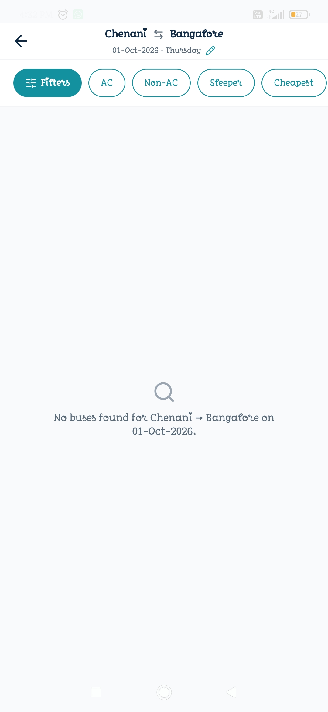
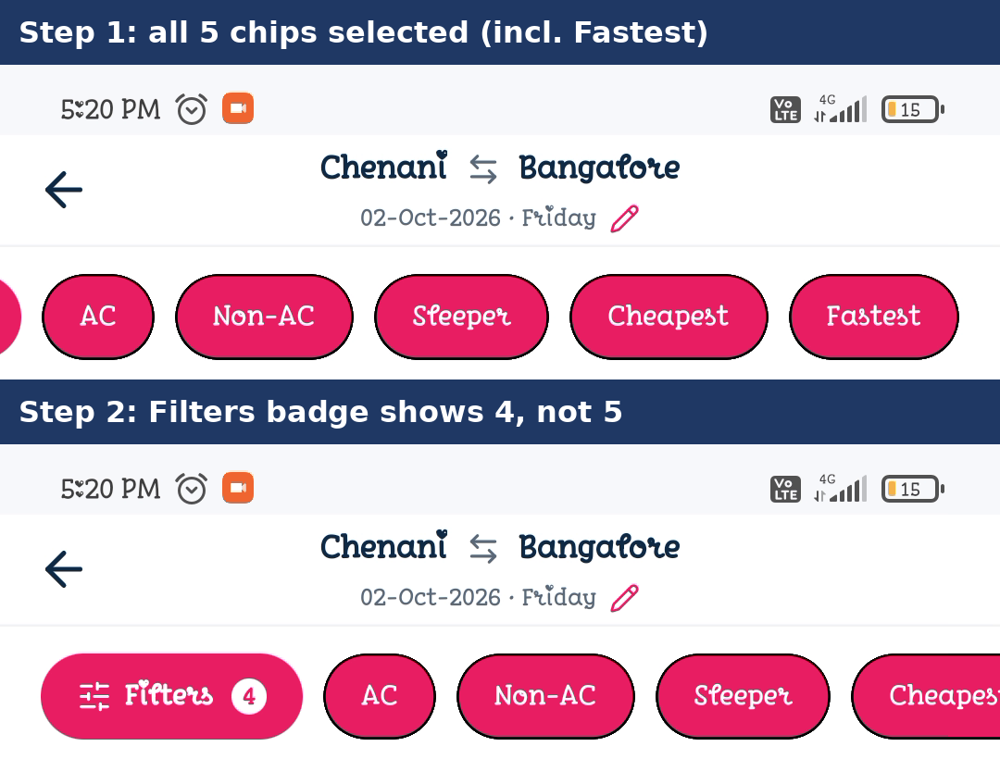
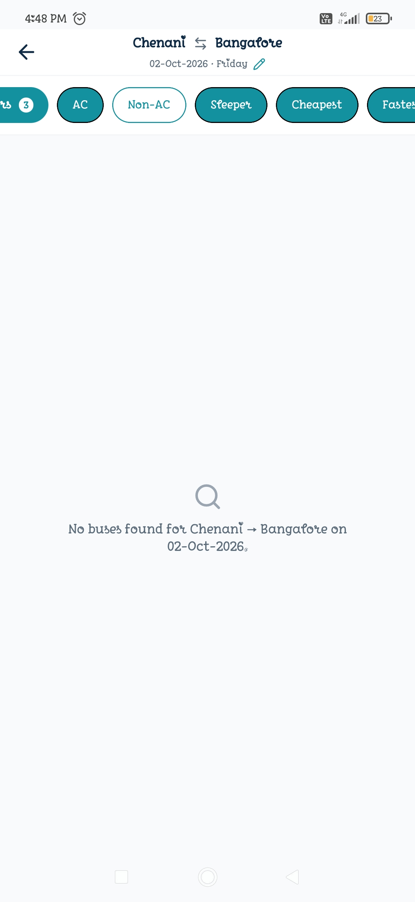
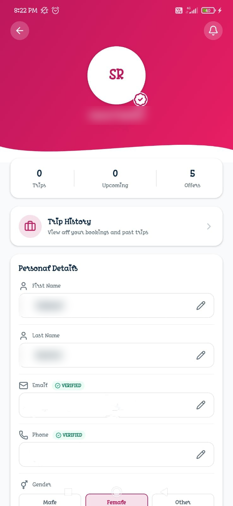

# Tripva Mobile App: Manual Testing

Manual testing of **Tripva**, a bus ticket booking mobile app, done as part of an app-testing assignment. I explored the app by hand (exploratory testing), found the bugs, and wrote the test cases from what I saw. Bugs were sent to the developer through a Google Form with bug name, severity, priority, reason and proof (screenshots / screen recordings).

## Test Environment
| Item | Details |
|---|---|
| Device | Redmi 9 Prime |
| OS | Android 10 |
| Testing type | Manual (functional, UI, exploratory) |
| Tester | SABARI ROHINI M |
| Bug reporting | Doc & Google Form|

## Scope
Bus search results, filters and sorting, notifications, and the user profile.

## Repository Structure
```
Tripva-Mobile-App-Testing/
├── README.md
├── Test_Cases.xlsx      29 test cases (module-wise)
├── Bug_Reports.xlsx     6 bug reports with steps, expected/actual, severity, priority
├── Test_Summary.xlsx    summary, by module, bugs by severity
└── Screenshots/         Bug_001 to Bug_006 (.png) and screen recordings (.mp4); Bug_006 screenshot pending
```

## Test Summary
| Module | Total | Pass | Fail | Blocked | Needs Clarification | Not Executed |
|---|---|---|---|---|---|---|
| Bus Search | 4 | 1 | 1 | 0 | 0 | 2 |
| Filters | 13 | 6 | 3 | 3 | 1 | 0 |
| Notifications | 5 | 1 | 2 | 0 | 0 | 2 |
| Profile | 7 | 1 | 2 | 0 | 0 | 4 |
| **Total** | **29** | **9** | **8** | **3** | **1** | **8** |

_Statuses are based on what I saw in the screenshots and recordings. "Not Executed" cases are planned but not yet run on the device; run them and update Status and Actual Result._

## Bugs Found
| ID | Title | Severity | Priority | Evidence |
|---|---|---|---|---|
| BUG-001 | No buses listed on Redmi 9 Prime for Chennai → Bangalore, while the same search lists buses on other phones | High | High |  |
| BUG-002 | Filters badge shows 4 when all 5 filter chips are selected | Low | Low |  |
| BUG-003 | Filters badge count is one less than the selected chips (4 chips selected, badge shows 3) | Low | Low |  |
| BUG-004 | Tapping a notification does nothing (does not open the related screen) | Medium | Medium |  |
| BUG-005 | No option to add or change profile picture on the Profile screen | Low | Low |  |
| BUG-006 | Unable to add an emergency contact on the Profile screen | Low | Low ||

Screen recordings: `Screenshots/Bug_002.mp4`, `Screenshots/Bug_004.mp4`.

Note: the results header in Bug_001.png reads 'Chenani' instead of 'Chennai'; confirm whether this is the cause of BUG-001.

## Notes
- Personal details (name, email, phone) are blurred or removed from the screenshots.

